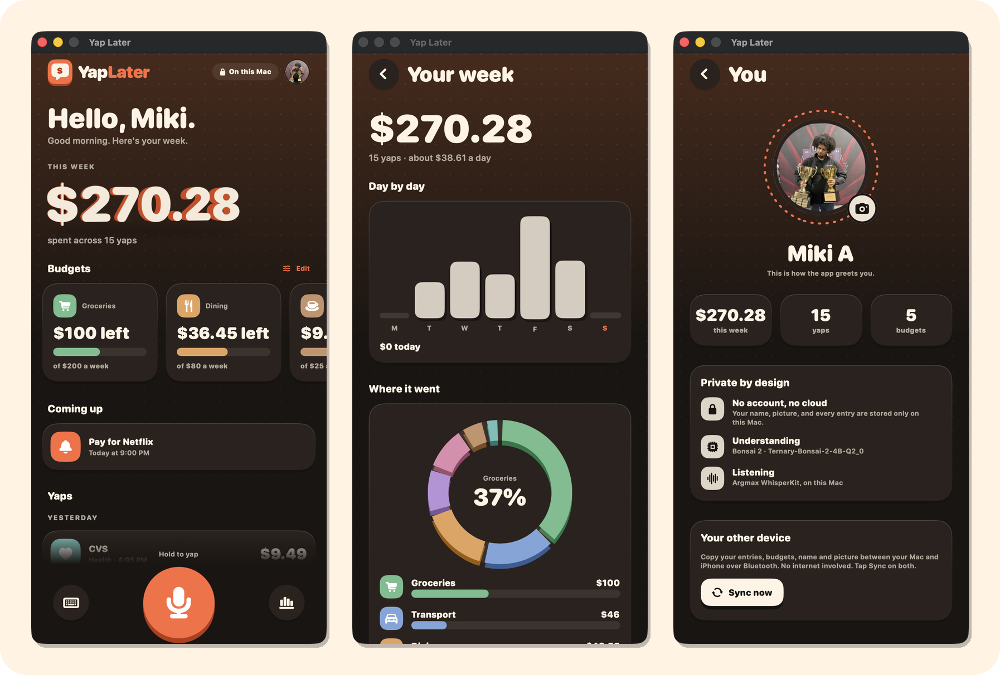
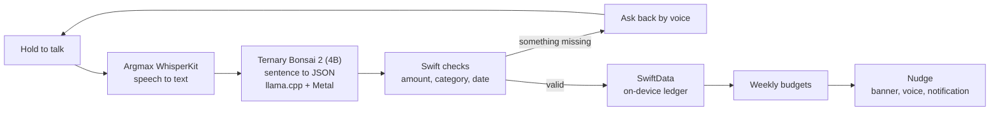

<h1 align="center">
  <picture>
    <source media="(prefers-color-scheme: dark)" srcset="docs/images/logo-dark.png">
    
  </picture>
</h1>

<p align="center">
  <b>Talk to your money. It never leaves your hands.</b><br>
  A voice-first budget for iPhone and Mac where the speech recognition, the language model,<br>
  and every dollar you log stay on your device. No bank login. No account. No internet.
</p>

<p align="center">
  iPhone and Mac · runs with Wi-Fi off · PrismML Ternary Bonsai 2 · Argmax WhisperKit and TTSKit · SwiftUI
</p>

<p align="center">
  
</p>

<p align="center"><sub>The Mac build, showing the demo week described under <a href="#honest-limitations">Honest limitations</a>. The name and picture arrived from the iPhone over Bluetooth.</sub></p>

Built in one weekend for Cornell's Local AI Hackathon (November 14–15, 2026). The theme was **Recreate**: take an AI app that already exists and remake it so it runs fully on-device.

## The idea in thirty seconds

Budgeting apps like Rocket Money start by asking for your bank login, and their AI thinks in someone else's data center. Plenty of people stop right there, especially anyone who already suspects that "AI" means "something is taking my information."

Yap Later recreates the AI budgeting assistant with that worry designed out:

1. **Hold a button and say what you spent.** "Just spent fifty bucks on groceries at Walmart."
2. **The device understands it.** Speech becomes text, and a language model turns the sentence into an amount, a category, and a merchant. Both run on your iPhone or Mac.
3. **Your budget answers back.** The Groceries budget fills, and when it runs low you see and hear it: "Only $50 left for Groceries this week."

There is nothing to sign up for and nothing to connect. Turn on airplane mode and it works exactly the same.

## Who it is for, and when

- **People who will not hand over a bank login**, or who do not trust AI with their information. Here the claim "your data stays with you" is checkable: switch the network off and nothing changes.
- **People new to AI** who want to see what a small model can do without creating an account anywhere.
- **Anyone without a connection**: on a plane, abroad without data, in a store basement, on a dead-zone commute. Spending happens in exactly the places signal does not.

## What it does

| You say or do | What happens |
|---|---|
| "Grabbed lunch at Chipotle, thirteen forty five" | Saved as $13.45 · Dining · Chipotle, with an Undo |
| "Grabbed a coffee" | It asks, out loud, "How much was it?" and waits for your answer. It never invents an amount |
| "Twelve on lunch, fifteen at the pharmacy and twenty on a shirt at Target" | Three expenses from one sentence; one Undo removes all three |
| "Set my coffee budget to twenty five a week" | A weekly budget, created by voice |
| An expense pushes a budget low | A banner, a spoken warning, and a notification: "Only $50 left for Groceries this week" |
| "Remind me to pay rent tomorrow at six pm" | A card shows the title and exact time; tapping Save creates an Apple Reminder with an alert |
| Tap the chart button | Your week in charts: spending by day, a category ring you can tilt, and a short list of what deserves attention |
| Tap your picture | A profile page with your name and photo, kept on the device, and a button that syncs your entries, budgets, name and picture between Mac and iPhone over Bluetooth |
| Press the Action Button | "Start a Yap" opens the app already listening |

A week runs Monday through Sunday. Any entry can be corrected by tapping it.

## How it works



Every box runs on the device. There are no network calls in the app.

**The model proposes; app code decides.** Bonsai's output is constrained by a grammar to a single JSON object, so it cannot ramble. Swift code then checks that the amount is one you actually said, maps the category to a fixed set, resolves dates like "yesterday", and asks back when something is missing. The model never touches storage, and a number it made up cannot be saved.

### How the sponsor models are used

| Sponsor | Model | What it does here |
|---|---|---|
| **PrismML** | Ternary Bonsai 2 4B (Q2_0 GGUF, 1.2 GB) | Reads each sentence and proposes the expense, budget, or reminder. Runs in-process through llama.cpp on the GPU, on both iPhone and Mac |
| **Argmax** | WhisperKit 1.1.1 with Whisper small | Turns held-to-talk audio into text. A vocabulary prompt makes it write amounts as words, because "650" loses the difference between $6.50 and $650 |
| **Argmax** | TTSKit with Qwen3-TTS 0.6B | Speaks questions and nudges on the Mac. It also runs on the iPhone, where it is off by default because it loads slowly there |

## Measured, not estimated

| What | Result |
|---|---|
| Bonsai 2 4B on a 23-sentence check (expenses, number words, missing amounts, budgets, reminders, off-topic), iPhone 17 Pro | 23 of 23 correct, median 1.3 s per sentence |
| The same check on an Apple Silicon Mac | 23 of 23, median 0.56 s |
| Bonsai 2 2B on the earlier 20-sentence check, iPhone | 12 of 20, about 0.7 s. The 4B ships |
| WhisperKit on a 2 to 6 s yap, iPhone | 0.25 to 0.85 s |
| Argmax voice, time to first audio | 0.2 to 0.5 s on the Mac, 0.3 to 0.6 s on the iPhone |
| Airplane mode on the iPhone, Wi-Fi off on the Mac | The full loop was run by hand on both and worked |
| Mac check with all network access denied to the app's process | 23 of 23; a typed budget and expense were saved and the nudge was spoken |
| Bluetooth sync | Entries logged on the iPhone arrived on the Mac, and so did the name and picture set on the iPhone |
| Unit tests | 51 passing |

The report is in [`eval/results/`](eval/results/). The check sentences are synthetic and a few overlap with example wording, so read the score as a sanity check, not a benchmark. [`docs/FEASIBILITY.md`](docs/FEASIBILITY.md) lists what was verified, how, and what was not.

## Designed, not generated

We wanted an app that feels made by people who care, not a dark screen with a chat box. The rule we held ourselves to: **an animation has to explain something.**

- **The weekly total is a thick, coin-like number.** Swipe it and it spins with the speed of your finger; it turns once on its own when new money is logged.
- **A budget steps forward when it takes a hit.** The card grows, the bar fills from the old amount to the new one, and it settles back.
- **Charts build themselves from your entries.** Columns rise day by day, the category ring sweeps open and leans toward your finger.
- **Speech bubbles rise when the app opens**, and the logo wobbles if you poke it.
- **One loud color.** Warm paper and espresso backgrounds, cream ink, and a single orange. Category colors are deliberately quiet.
- **Reduce Motion is respected everywhere**: movement becomes a crossfade, never a missing state.

The design notes are in [`docs/DESIGN.md`](docs/DESIGN.md), and the motion values the whole app shares are in [`Motion.swift`](app/YapLater/DesignSystem/Motion.swift).

## Right-sized by measurement

The sustainability question for local AI is whether the work is sized to the task.

- **The smallest model that passes.** Both ternary Bonsai 2 sizes ran on the same phone and sentences; the 2B fell short, so the app ships the 4B and nothing larger.
- **One short model call per expense.** Output is limited by a grammar to one JSON object of at most 140 tokens, with the reasoning block skipped. A reminder takes two calls.
- **The fixed prompt is read once.** The 947-token instructions and examples are processed one time and restored from a snapshot, so each yap only costs the new sentence.
- **Plain code where a model is not needed.** Checking amounts, date math, budget math, nudge wording, the follow-up question, splitting a ramble, and every chart are ordinary Swift.
- **A small speech model, only while you hold the button.** No background listening.
- **No server.** There is no data-center inference at all.

Not measured: energy or battery use. No claim is made here about joules or carbon.

## Run it

### On a Mac (Apple Silicon, macOS 26, Xcode 26.6)

```sh
scripts/setup_mac.sh        # fetches llama.cpp, downloads Bonsai 2 4B and Whisper small once, builds the app
                            # add --voice to also download the Argmax voice (1.1 GB)
open build/mac/Build/Products/Debug/YapLater.app
```

Then turn Wi-Fi off and hold the orange button to talk, or use the keyboard button to type. The Mac build is the same code as the iPhone build, signed to run locally, so no Apple developer account is needed. Models live in `~/Library/Application Support/YapLater`. The script's download step was checked only by confirming the URLs respond; on the development Mac the models were copied from a local download.

### On an iPhone (iOS 26, about 2 GB free)

```sh
scripts/fetch_llama.sh                      # llama.cpp framework into app/Vendor (not in Git)
open app/YapLater.xcodeproj                 # set your signing team, build to your iPhone
```

Then copy the models into the app's Documents folder (they are not in Git):

```sh
# Bonsai 2 4B, Q2_0: https://huggingface.co/prism-ml/Ternary-Bonsai-2-4B-gguf
xcrun devicectl device copy to --device <id> --domain-type appDataContainer \
  --domain-identifier com.mikiyas.yaplater --source Ternary-Bonsai-2-4B-Q2_0.gguf \
  --destination Documents/models/Ternary-Bonsai-2-4B-Q2_0.gguf
# Whisper small for WhisperKit (argmaxinc/whisperkit-coreml: openai_whisper-small, plus tokenizer.json
# and tokenizer_config.json from openai/whisper-small in the same folder)
xcrun devicectl device copy to --device <id> --domain-type appDataContainer \
  --domain-identifier com.mikiyas.yaplater --source speech --destination Documents/speech
```

Unit tests: `xcodebuild test -project app/YapLater.xcodeproj -scheme YapLater -destination 'platform=iOS Simulator,name=iPhone 17 Pro' CODE_SIGNING_ALLOWED=NO`. The simulator uses mock speech and has no llama framework. Exact commands and results are in [`docs/COMMANDS.md`](docs/COMMANDS.md).

## Honest limitations

- **The video and screenshots start from a demo week**: five earlier days of made-up, ordinary spending loaded with `scripts/demo_week.sh`, so the charts and budgets have some history. It is demo data, not anyone's real spending. Everything said into the app during the video is interpreted live.
- English and US dollars only.
- A sentence with several expenses is split in app code at commas and joining words, one amount per part. If any part is not a clear expense, the whole sentence is treated as one request.
- The app checks that the proposed amount matches a number you said; unusual phrasings of amounts may make it ask again.
- Sync copies entries and budgets that the other device lacks, plus your name and picture (whichever device changed them last wins). Edits and deletions do not travel, and reminders are not synced.
- Reminders are saved to Apple Reminders only after you tap Save.
- On the iPhone the spoken voice is the system voice by default. The Argmax voice works there too but takes about 20 s to load; `scripts/voice.sh iphone on` switches it on.
- If no Bonsai file is present, the app falls back to Apple's on-device model, and to a labeled MOCK if neither is available. The profile page shows which is in use.
- Location-based nudges were designed but not built.

## Around the repository

| Path | What is there |
|---|---|
| [`app/YapLater/`](app/YapLater/) | The app: `Domain` (pure Swift rules), `Services` (speech, model, sync, reminders), `Store`, `Features` (screens), `DesignSystem` |
| [`app/YapLaterTests/`](app/YapLaterTests/) | 51 unit tests for amounts, dates, budgets, the voice loop, sync merging, and the chart numbers |
| [`docs/PITCH.md`](docs/PITCH.md), [`docs/video-script.pdf`](docs/video-script.pdf) | The 2-minute video script and the clips to record |
| [`docs/FEASIBILITY.md`](docs/FEASIBILITY.md) | What was verified on real devices, and what was not |
| [`docs/CONTRACTS.md`](docs/CONTRACTS.md), [`contracts/`](contracts/) | How a sentence becomes stored data, with the JSON shapes the model must return |
| [`docs/DESIGN.md`](docs/DESIGN.md) | The look and the motion rules |
| [`eval/`](eval/) | The test sentences and the on-device model report |
| [`scripts/`](scripts/) | Mac setup, model fetching, demo week, voice switch |

## Credits

Built by Mikiyas Asmamaw. Released under the [MIT License](LICENSE).

Ternary Bonsai 2 by PrismML. WhisperKit and TTSKit by Argmax. llama.cpp by ggml-org and contributors. Whisper by OpenAI. Qwen3-TTS by Alibaba's Qwen team.

This project was written with AI coding assistance from cloud models, so it does not qualify for, and does not claim, the Locally Made subtrack.
